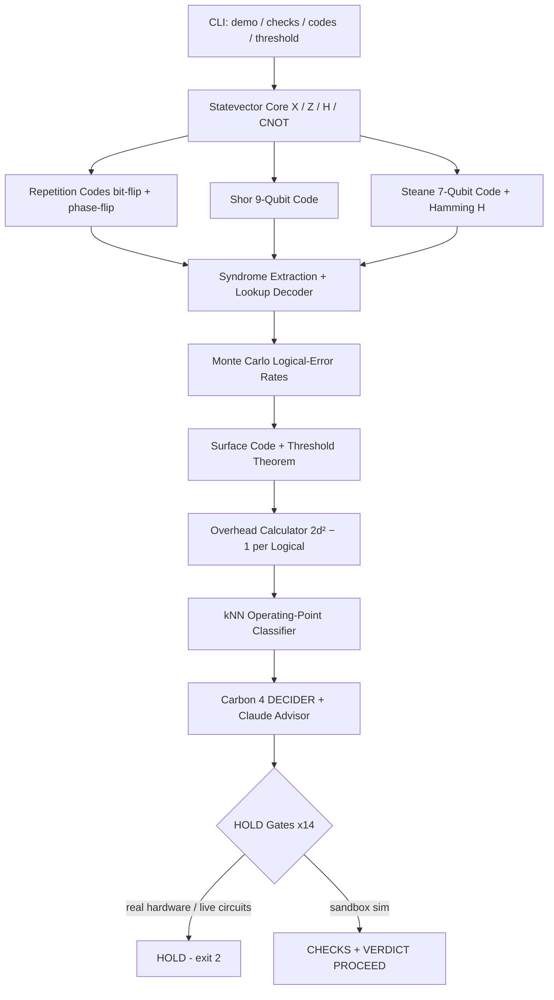
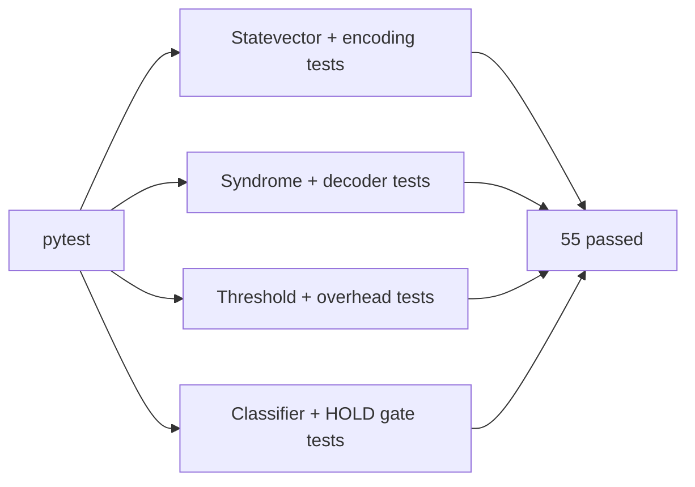
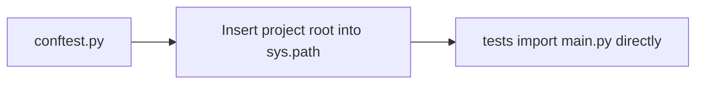
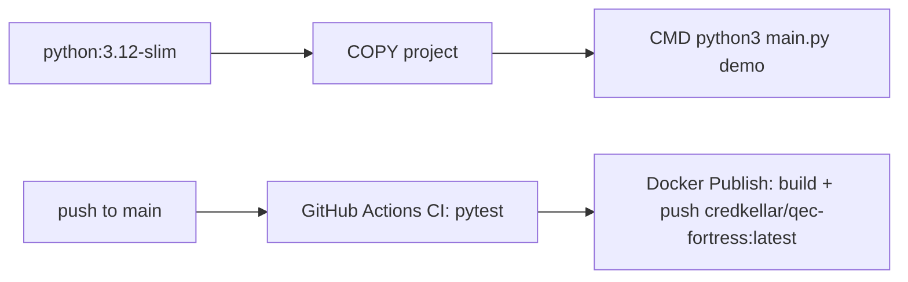

# QEC-Fortress 🛡️⚛️

**Quantum Error Correction Lab** — an educational quantum error correction lab in ONE pure-Python file, by Darion Kellar. Qubits are the most fragile information carriers ever built; this lab is the mathematics that keeps them alive: the **3-qubit bit-flip and phase-flip codes**, **Shor's 9-qubit code**, the **Steane [[7,1,3]] code**, real **syndrome extraction** on an exact statevector simulator, **lookup and majority-vote decoders**, seeded **Monte Carlo** logical-error measurement, the **threshold theorem** (below ~1% physical error, bigger codes suppress logical error — above it, they amplify it), **surface-code distance scaling**, and a **fault-tolerance overhead calculator** that turns an error rate into a physical-qubit bill. Simulation and learning only — no hardware, no live circuits, no protected-computation claims; every real-world operation sits behind a permanent HOLD gate (14 total). 🔒


> ℹ️ The two workflow badges above are the **live** GitHub Actions badges for this repo — they light up as soon as the `ci.yml` and `docker-publish.yml` files from the paste pack are pasted into `.github/workflows/`.

## 🧰 Tech Stack Badges & Full Architecture Tech Stack

### 💻 Core Programming Languages & Core Systems


- 🐍 Python 3.12, pure standard library (`math`, `hashlib`, `json`, `random`, `sys`) — ONE file: `main.py`
- ⚛️ QEC core: exact statevector simulator (X / Z / H / CNOT), stabilizer syndrome extraction by Pauli expectation, Shor [[9,1,3]] and Steane [[7,1,3]] codes, Hamming [7,4,3] parity-check decoding, surface-code fit pL ≈ 0.1·(p/p_th)^((d+1)/2) with p_th = 1%
- 🧠 TinyML kNN operating-point classifier (from scratch, stdlib) on threshold-landscape features (log p/p_th, distance, log pL)
- 🧑‍⚖️ Advisory seats inside `main.py`: Gemini Carbon 4 DECIDER (names-only, tighten-only, sha256 trace), Muse advisor (can_override_hold = False), Google Flow plan-only (rendered = False, live = 0)

### ⛓️ Web3 & Infrastructure

Not used — this lab is an offline mathematics simulation. No blockchain, no Web3 libraries, no network calls of any kind.

### ⚙️ Platform Support & Hardware Architecture


- 🖥️ Runs anywhere Python 3.12 runs — Linux, macOS, Windows, any CPU architecture
- 🚫 Controls **no quantum hardware**: no devices, no backends, no calibration (all behind HOLD gates)

### ⚡ Low-Level Infrastructure & Performance


- 🚀 Zero dependencies, zero network, zero install friction for the lab itself
- 🎯 Deterministic end to end: every Monte Carlo run is seeded — run it twice, get byte-identical output

### 🛠️ DevOps & Build Tools


- 🐳 Docker image (`python:3.12-slim`), target: `credkellar/qec-fortress:latest`
- ⚙️ GitHub Actions CI + Docker Publish workflows — delivered in the paste pack for `.github/workflows/`

### ☁️ Cloud Providers

Not used — this lab runs fully offline on your own machine or in a local Docker container. No cloud account, no API keys, no hosted quantum backends.

## What this does?

1. 🎯 **The enemy, measured** — a bare qubit under depolarizing noise fails at rate p. Every code in the lab is scored against that baseline, by exact math and by Monte Carlo.
2. 🔁 **3-qubit bit-flip code** — |0⟩→|000⟩, |1⟩→|111⟩; stabilizers Z₀Z₁, Z₁Z₂; the exact logical rate pL = 3p² − 2p³, with break-even at p = 0.5: below it the code helps, above it the code *hurts*.
3. 🌀 **3-qubit phase-flip code** — the same code in the X basis (|+++⟩, |---⟩), because quantum errors come in both flavours and a real code must fight both.
4. 🛡️ **Shor's 9-qubit code** — the 1995 concatenation that corrects **any** single-qubit error: bit flips inside each block of 3, phase flips by majority vote across block signs. Proven here exactly: all 27 single-qubit Pauli errors (9 qubits × X/Y/Z) are corrected with fidelity 1.0.
5. 7️⃣ **Steane [[7,1,3]] code** — a CSS code built from the classical [7,4,3] Hamming code: every nonzero syndrome names exactly one qubit, and the decoder's success test is exact (residual must be a stabilizer, not a logical operator).
6. 🩺 **Syndrome extraction** — on a real (simulated) statevector: Pauli-string expectation values give ±1 eigenvalues, the violated checks form the syndrome, and a lookup table turns syndrome → correction. You watch it happen in the demo.
7. 🎲 **Monte Carlo simulation** — Pauli-frame trials with a fixed seed: bare vs repetition vs Shor vs Steane at the same noise, reproducible to the last digit.
8. 📉 **Logical vs physical error curves** — the repetition code's curve crosses the bare-qubit line at p = 0.5; the surface code's family of curves pivots around the threshold p_th ≈ 1%.
9. 🏯 **The threshold theorem** — below p_th, raising distance d suppresses pL without limit; at p_th the curves sit flat at 0.1; above p_th, raising d makes pL *grow*. `required_distance()` returns `None` above threshold — the impossibility is the theorem.
10. 🧮 **Surface-code scaling + overhead calculator** — a rotated patch costs 2d² − 1 physical qubits per logical (d = 21 → 881). Feed in a physical error rate, a target logical error, a logical-qubit count and an operation budget, and get the full physical-qubit bill — or an honest "infeasible" above threshold.
11. 🧠 **kNN classifier + advisory seats** — a from-scratch kNN labels any (p, d) operating point `fortress` / `protected` / `marginal` / `unprotected`; Carbon 4 DECIDER, Muse advisor, Google Flow plan-only; built-in CHECKS suite (46 checks).

## 🗺️ How it works — diagram per script

### `main.py` — the whole lab



### `tests/test_main.py` — verification



### `conftest.py` — test path setup



### `Dockerfile` + CI — container & workflow flow



## Why is this cool?

1. 🛡️ Error correction is the moment quantum computing stops being a physics demo — and this lab makes you *compute* with it, not just read about it.
2. 🎯 The break-even lesson lands in one line of math: at p = 0.6 the 3-qubit code fails at 0.648 — encoding bad qubits makes things *worse*, and you can prove it.
3. 🩺 Syndrome extraction is shown, not described: an X error lands, two parity checks light up (1, 1), the lookup names the guilty qubit, fidelity returns to exactly 1.0.
4. 9️⃣ Shor's code corrects an error it cannot even name in advance — X, Z, or Y, on any of 9 qubits — and the lab verifies all 27 cases exactly.
5. 📉 The threshold theorem is the deepest idea in the field, and here it is a table you can regenerate: same code, p = 0.5% shrinks errors with distance, p = 2% explodes them.
6. 💸 The overhead calculator prints the field's most sobering invoice: one well-protected logical qubit at p = 0.1% costs 881 physical qubits; a 1000-logical-qubit machine costs 881,000.
7. 🎲 Monte Carlo and closed-form math check each other — the simulation earns trust because the analytic answer is sitting right next to it.
8. 7️⃣ The Steane decoder's success test is the real one from the theory: a correction counts only if the residual is a stabilizer, never hand-waved.
9. 🏷️ A tiny from-scratch ML classifier learns the shape of the threshold landscape — including the cliff edge at p_th.
10. 🎯 Deterministic end to end: seeded Monte Carlo means run it twice, get byte-identical output — physics you can diff.

## What problems this solves?

1. ❌ **Problem:** "Quantum error correction" gets treated as a magic shield word. ✅ **Solution:** The lab shows it is arithmetic — redundancy, syndromes, decoders — with exact failure rates you compute yourself.
2. ❌ **Problem:** People think adding qubits always helps. ✅ **Solution:** The repetition code above p = 0.5 and the surface code above p_th both get *worse* with size; the lab demonstrates both failures numerically.
3. ❌ **Problem:** Bit flips are taught, phase flips are forgotten. ✅ **Solution:** Both repetition codes are built and tested, and Shor/Steane handle the full Pauli set {X, Y, Z}.
4. ❌ **Problem:** Syndrome measurement sounds like it would destroy the quantum state. ✅ **Solution:** The statevector demo shows parity checks reveal the *error* while the logical amplitudes (0.6, 0.8) survive untouched and are restored exactly.
5. ❌ **Problem:** Headlines quote logical-qubit counts with no price tag. ✅ **Solution:** The overhead calculator converts any headline into physical qubits: 2d² − 1 per logical, distance chosen from your error budget.
6. ❌ **Problem:** The threshold gets quoted as a vibe ("about 1%"). ✅ **Solution:** The threshold table shows the pivot concretely — flat at p_th, suppression below, amplification above.
7. ❌ **Problem:** Decoder correctness is usually asserted, not proven. ✅ **Solution:** All 27 single-qubit Pauli errors on Shor's code and all 7 positions on Steane's are corrected in tests, and Steane residuals are checked against the stabilizer group itself.
8. ❌ **Problem:** Simulation results differ run to run, so numbers can't be trusted or taught. ✅ **Solution:** Fixed-seed Monte Carlo: identical output on every run, verified byte-for-byte.
9. ❌ **Problem:** QEC code usually needs a heavy framework (Qiskit / Cirq / Stim) before the first line runs. ✅ **Solution:** Pure standard library — a 512-amplitude statevector and Pauli-frame Monte Carlo in ONE file, zero pip installs for the lab itself.
10. ❌ **Problem:** Simulation tools quietly imply real-world readiness. ✅ **Solution:** The surface-code fit is labelled a model everywhere it appears, no real computation is claimed protected, and 14 HOLD gates return exit code 2 for every live-hardware action.

## How to install this?

1. 📥 Clone the repo:

```bash
git clone https://github.com/kimanicollier44-cmyk/QEC-Fortress.git
cd QEC-Fortress
```

2. 🐍 Make sure Python 3.12+ is installed: `python3 --version`
3. ▶️ Run the full demo + checks (no arguments needed):

```bash
python3 main.py
```

4. 🧪 Run the test suite:

```bash
pip install pytest
python3 -m pytest -q
```

5. 🎛️ Try the other commands:

```bash
python3 main.py checks      # 46 built-in checks
python3 main.py codes       # the code zoo as JSON
python3 main.py threshold   # logical error vs distance around p_th
python3 main.py surface     # physical qubits per logical vs distance
python3 main.py overhead    # fault-tolerance bills for named scenarios
python3 main.py montecarlo  # bare vs rep3 vs Shor vs Steane, seeded
python3 main.py classify    # kNN verdicts for named operating points
python3 main.py brains      # Carbon 4 + Muse + Flow seats
python3 main.py holds       # list all 14 HOLD gates
python3 main.py hold-demo   # exits 2 - gated actions stay HOLD
```

6. 🐳 Or run it in Docker:

```bash
docker build -t credkellar/qec-fortress:latest .
docker run --rm credkellar/qec-fortress:latest
```

## Requirements

- 🐍 Python 3.12 or newer — standard library only
- 📦 Dependencies: **none**
- 🌐 Network: **none** — fully offline
- 🧪 Optional, for tests only: `pytest`
- 🐳 Optional: Docker

## FULL project structure tree

```text
qec-fortress/
├── main.py                  # the whole lab: statevector core, rep3/Shor/Steane codes, decoders, Monte Carlo, threshold, overhead, classifier, seats, HOLD gates
├── conftest.py              # puts the project root on sys.path for tests
├── tests/
│   └── test_main.py         # 55 pytest tests: statevector, codes, decoders, threshold, overhead, gates, determinism
├── assets/
│   └── cover.png            # README cover image (2736 x 912)
├── Dockerfile               # python:3.12-slim, runs the demo
├── .gitignore               # Python cache / venv ignores
└── README.md                # this file
```

> 📦 Delivered separately as paste packs (not in this tree): `.github/workflows/ci.yml` + `docker-publish.yml`, and the Docker Hub pack (100-char description, 350-char About, overview, categories).

## 🔒 HOLD gates — all 14, permanent

| Gate | What stays held |
|---|---|
| `real_quantum_hardware` | No connection to or control of any real quantum hardware |
| `live_circuit_execution` | No live circuit execution on any quantum device or cloud backend |
| `vendor_cloud_submission` | No job submission to any quantum cloud vendor |
| `remote_device_access` | No remote access, calibration, or tuning of quantum devices |
| `hardware_procurement_planning` | No procurement / purchase planning for quantum hardware |
| `fault_tolerant_computer_claim` | No claim this simulation is, or runs on, a fault-tolerant quantum computer |
| `protected_computation_claim` | No claim any real computation or real data is protected by this lab |
| `cryptographic_security_claim` | No claim QEC here makes any real cryptographic system secure or broken |
| `cryptanalysis_live` | No live cryptanalysis of real keys, real ciphers, or real systems |
| `medical_claim` | No medical, diagnostic, or clinical claims |
| `weapons_application_claim` | No weapons or military application claims |
| `investment_advice_claim` | No investment advice about quantum-computing companies or stocks |
| `commercial_product_claim` | No claim this simulation is a commercial product or certified design |
| `peer_reviewed_result_claim` | No claim these teaching numbers are peer-reviewed research results |

🧑‍⚖️ **Council seats:** Gemini Carbon 4 DECIDER (names-only, tighten-only, MAP→MODEL→STRESS→DECIDE, sha256 trace) · Muse advisor (`can_override_hold = False`) · Google Flow plan-only (rendered = False, live = 0).

✅ **Verification:** pytest **55 passed** · built-in **CHECKS 46/46** · `python3 main.py` → VERDICT PROCEED (sandbox simulation only) · double-run byte-identical · hold-demo exits 2.

## 📏 Honest status

- 🧪 **Simulated, not real hardware.** Every state in this lab lives in a Python list on a classical laptop. Nothing connects to, runs on, or is protected by any quantum device — those actions are HOLD gates, permanently.
- 📐 **The surface-code numbers are a model.** pL ≈ 0.1·(p/p_th)^((d+1)/2) with p_th = 1% is the standard phenomenological fit used for back-of-envelope resource estimates. Real devices have correlated errors, leakage, and crosstalk that no closed-form fit captures; treat the overhead bill as the right *shape* of the truth, not a quote.
- 🎲 **Monte Carlo is exact about its own model.** Depolarizing noise, independent per qubit, decoded with the textbook lookup / majority rules. Real decoders (minimum-weight matching and beyond) and real noise differ — the lab says so instead of hiding it.
- 🏆 **What IS exact:** the statevector syndrome extraction, all single-Pauli corrections on the repetition, Shor, and Steane codes, the repetition code's closed-form 3p² − 2p³, and the Hamming syndrome algebra. Those are mathematics, verified by the test suite.

## 🧒 5th-grade English section

A quantum bit is like a soap bubble holding a secret number. 🫧

- The bubble pops **very** easily. Heat, shaking, even looking at it wrong can flip the number. That flip is called an **error**.
- So scientists hide **one** secret number inside **many** bubbles at once. If one bubble flips, the others still remember the secret. That trick is called **quantum error correction**.
- Helpers keep asking the bubbles simple yes-or-no questions like "do you two still match?" The answers form a secret code called a **syndrome**. The syndrome tells you *which* bubble flipped — without ever peeking at the secret itself! 🩺
- This lab builds the three most famous versions of the trick: a 3-bubble team, a 7-bubble team, and Shor's 9-bubble team, and it counts exactly how often each team saves the secret.
- There is a magic line called the **threshold**. If each bubble pops less than about 1 time in 100, bigger teams protect the secret better and better. If bubbles pop *more* often than that, bigger teams actually do **worse** — the helpers get confused! 📉
- Protecting one secret number really well can take **881 bubbles**. Keeping secrets is expensive — that is the honest bill this lab prints.
- This project is a **pretend lab on a computer**. It does not touch any real quantum machine. It helps you learn the math that real quantum scientists use every day. 💻

---

MIT © 2026 Darion Kellar · QEC-Fortress — educational simulation only 🛡️
